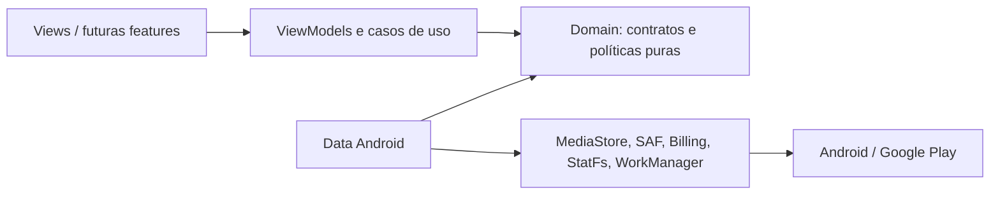

# Arquitetura 2027

## Estado encontrado

O projeto contém dois módulos Gradle (`:app` Android e `:domain` Kotlin/JVM), UI Android Views com quatro seções em `MainActivity`, `MediaScanViewModel` com `StateFlow`, regras puras para paginação/seleção/agrupamento/OaaS/Billing e adaptadores Android para MediaStore, operações de mídia, telemetria local e Google Play Billing. A Activity ainda é proprietária da navegação e de grande parte da composição/renderização; não é uma arquitetura de features isoladas.

A configuração atual usa Gradle 8.13, JDK 17, Android SDK 36 e applicationId com.rdf112.midiastore. A baseline Debug de 03/11 pertence a uma revisão anterior; a branch de recuperação ainda precisa de CI verde, teste instrumentado e validação em aparelho. Não declarar Release assinado ou publicado.

## Direção

A regra de dependência é `UI -> domain contracts`; adaptadores implementam contratos e dependem de APIs Android. O domínio não importa Android, Billing, Views ou SDKs de IA.

## Limites propostos

- **Storage:** snapshot de `StatFs`, amostras locais e previsão com incerteza explícita.
- **Media catalog:** MediaStore por volume/tipo, paginação estável, permissões e cobertura.
- **Media intelligence:** filtros e hash exato; mais tarde perceptual hash em fluxo de revisão separado.
- **Safe cleanup:** planos imutáveis, revalidação, consentimento oficial, reconciliação pós-operação e accounting.
- **Files:** MediaStore para mídia; SAF para documentos/Downloads selecionados.
- **Billing:** catálogo/flow client e estado de entitlement; validação confiável não pode depender de SharedPreferences.
- **Automation:** WorkManager só para análises/relatórios opt-in, nunca remoção automática.

Não criar módulos Gradle vazios agora. Primeiro estabilizar contratos, testes e release. Considerar `:feature:storage`, `:feature:media`, `:feature:files` ou `:feature:billing` apenas quando houver código independente, dono/testes próprios e dependências unidirecionais que justifiquem o custo.

## Revisão de contratos

- `MediaPageRepository`: mantém página limitada, sessão e erros; documentar ordenação do provider e fallback local.
- `MediaOperationContract`: separar plano preparado, consentimento e resultado observado; não oferecer API que permita executar sem confirmação do Android.
- `StorageSampleRepository`: guardar amostras por volume/capacidade; cota, retenção e exportação controladas.
- `BillingGateway`: expor catálogo carregando/disponível/indisponível/erro e não usar detalhes em cache após produto não encontrado.
- Toda operação longa recebe cancelamento; streams e cursores são fechados em `use`; UI coleta estado com lifecycle.

## Decisões de plataforma

- Preservar `applicationId=com.rdf112.midiastore`, confirmado pelo proprietário na ficha de teste interno. O namespace técnico continua `com.rdf112.sweep`; não confundir namespace com package de instalação. Confirmar maior versionCode e certificado na Play Console antes do Release.
- `minSdk 29`, `targetSdk 36`, `compileSdk 36`, Java 17; consultar Play target policy a cada release e testar API 37 antes da migração.
- Nada de root, ADB, Shizuku, `MANAGE_EXTERNAL_STORAGE` ou acesso privado de terceiros como requisito do MVP.
- Não adicionar Room, WorkManager, LiteRT ou MediaPipe sem um caso de uso aprovado e benchmark.

## Gatilhos de modularização

Extrair feature do `:app` quando pelo menos dois sinais ocorrerem: equipe independente, ciclo de release separado, API de domínio estável, redução demonstrável do grafo de dependências/tempo de build ou testes de feature isoláveis. Manter no domínio puro aquilo que pode ser testado sem Android.

## Atualização de arquitetura — 04/11/2026

O medidor principal consulta agora o armazenamento compartilhado primário, não a partição privada /data. O cálculo está isolado em StorageUsageCalculator com quatro testes unitários; isso não significa que SD/USB estejam incluídos. Apresentar volumes adicionais separadamente quando forem enumerados e acessíveis.

O projeto permanece com dois módulos Gradle: app e domain. A MainActivity ainda concentra navegação, renderização e operações; não criar módulos vazios. Depois de obter baseline CI verde, refatorar em passos pequenos, extraindo contratos/estado e mantendo o domínio sem Android. Não fazer reescrita arquitetural antes de resolver scanner/MediaStore e instrumentação.

A promessa comercial passa a Phone Cleaner; armazenamento/MediaStore continuam como domínio técnico. Downloads/documentos usam SAF, se adicionados; não adicionar MANAGE_EXTERNAL_STORAGE sem prova de que MediaStore/SAF não atendem ao recurso central.
