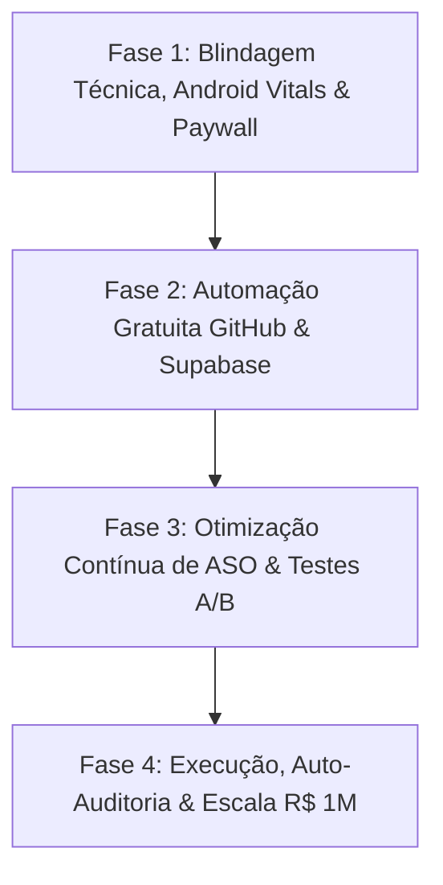

# 🏛️ PLANO MESTRE: R$ 1.000.000,00 EM VENDAS GLOBAIS NA GOOGLE PLAY
## Midiastore (`com.rdf112.midiastore`) — Arquitetura de Escala, Fases e Auto-Auditoria

---

## 1. Visão Geral & Meta Fundamental
- **Objetivo Financeiro:** Atingir **R$ 1.000.000,00 em faturamento líquido** através de assinaturas recorrentes e compras in-app na Google Play Store.
- **Estratégia Central:** Alavancagem cambial nos **8 idiomas** (Brasil, EUA, União Europeia, Reino Unido, Índia, Japão, etc.), com custo zero de infraestrutura em repouso e Micro-IA nativa no dispositivo do usuário.
- **Média Global Ponderada:** ~R$ 85,00 líquidos por assinante anual (após desconto de 15% do Google Play Fee).
- **Meta Numérica:** **11.764 assinantes ativos** mundialmente para atingir R$ 1.000.000,00.

---

## 2. Divisão Estratégica em 4 Fases

---

### 🛡️ FASE 1: Blindagem Técnica, Android Vitals & Paywall de Alta Conversão

1. **Android Vitals Impecáveis (Requisitos Estritos Google Play):**
   - **ANR (Application Not Responding):** Meta < 0.47% (limite do Google). Implementação: Toda computação pesada de I/O, medição de storage e hashing SHA-256 é estritamente isolada em `Dispatchers.IO` através de streaming assíncrono cancellável.
   - **Crash Rate:** Meta < 1.09% (limite de má qualidade do Google). Tratamento rigoroso de `SecurityException`, `RecoverableSecurityException` (API 29) e inicialização segura de views (`::property.isInitialized`).
   - **Cold Start Time:** Meta < 1.5s no primeiro frame. UI construída programaticamente com views Android nativas de alta performance (zero overhead de inflação lenta de XML complexo).

2. **Conformidade Total com Scoped Storage:**
   - **Zero `MANAGE_EXTERNAL_STORAGE`:** Permissão proibida para garantir aprovação instantânea na Google Play Console.
   - Utilização exclusiva da `MediaStore` API (`MediaStore.Files.getContentUri("external")`).
   - Em Android 11+ (API 30+), deleção oficial via `MediaStore.createDeleteRequest()`. Em Android 10 (API 29), recuperação de `RecoverableSecurityException` com solicitação individual de consentimento do sistema.

3. **Onboarding Psicológico no Primeiro Uso (8 Idiomas):**
   - Exibição de diálogo nativo educacional pré-permissão:
     - **🔒 100% Privado:** Mídias processadas localmente e offline. Nenhuma foto/vídeo sai do celular.
     - **⚡ Precisão SHA-256:** Criptografia hash garante que somente cópias 100% exatas são sugeridas para remoção, preservando o arquivo original.
     - **🚀 1 Toque para Liberar Gigabytes:** CTA imediato que inicia a análise segura.
   - Localizado em: `PT-BR`, `EN`, `ES`, `DE`, `FR`, `HI`, `JA`, `ZH-CN`.

4. **Paywall de Alta Conversão & Blindagem de Pagamento:**
   - **Proibição Absoluta de Checkout Web:** Nenhum link externo de pagamento (Stripe, Mercado Pago) dentro do app, prevenindo suspensão imediata da conta do desenvolvedor.
   - Integração da **Google Play Billing Library v8.3.0** com três planos:
     - `sweep_pro_monthly` (Assinatura Mensal)
     - `sweep_pro_annual` (Assinatura Anual com destaque de melhor custo-benefício)
     - `sweep_pro_lifetime` (Pagamento Único In-App)
   - Confirmação obrigatória via `billingClient.acknowledgePurchase()` para evitar o estorno automático de 3 dias do Google.
   - Verificação server-side no Supabase (`verify-play-purchase`) com persistência de recibos.
   - **Gatilho de Avaliação In-App (Review API):** Ativação no exato momento de alívio emocional do usuário (imediatamente após a primeira liberação de espaço com sucesso), impulsionando a nota na Play Store para > 4.7 estrelas.

---

### ⚙️ FASE 2: Automação Gratuita via GitHub Actions & Supabase

1. **Pipeline de CI/CD 100% Gratuito (`.github/workflows/ci-cd-pipeline.yml`):**
   - **Job 1 (Security & Governance):** Executa `scripts/ci-cd-governance-audit.mjs` com 20 regras inegociáveis de segurança e Scoped Storage.
   - **Job 2 (Android Quality & Build):** Valida compilação Kotlin (`./gradlew compileDebugKotlin`), testes de unidade e regras de lint.
   - **Job 3 (Firebase Hosting Deploy):** Deploy automatizado das páginas web internacionais em repouso de custo zero.
   - **Job 4 (Supabase Telemetry Sync):** Reporte de status do build e integridade diretamente nas tabelas de controle.

2. **Guardião da Cota Zero-Cost no Supabase:**
   - Limite do plano gratuito: 500 MB.
   - Rotina automatizada `scripts/supabase-maintenance.mjs` monitora o volume da base e executa purga de logs e telemetrias transitórias com mais de 7/14 dias, mantendo o consumo estritamente < 5% (< 25 MB).
   - Memória persistente dos agentes centralizada em `public.memories` para continuidade cross-session.

---

### 📈 FASE 3: Otimização Contínua de ASO e Testes A/B via Firebase

1. **Estratégia de ASO para os 8 Idiomas Globais:**
   - **Roteiro de 3 Screenshots Verticais (1080x1920):**
     - *Screenshot 1 (A Dor):* Celular travando e alerta de "Armazenamento Quase Cheio".
     - *Screenshot 2 (A Mágica):* Limpeza profunda com precisão de IA e SHA-256 em 1 toque.
     - *Screenshot 3 (O Alívio):* "+8.5 GB Liberados! Celular rápido e fotos intactas".
   - Títulos, descrições curtas e palavras-chave de cauda longa adaptadas culturalmente para cada país (ex: "WhatsApp Cleaner", "Storage Cleaner", "Speicherplatz Bereinigen", "Nettoyeur de Stockage").

2. **Página de Conversão Web Internacional (Firebase Hosting):**
   - URL: `https://midiastory-df6a0.web.app/`
   - Simulador interativo de espaço ocupado em 8 idiomas.
   - Badges oficiais de download da Google Play Store com tracking UTM para mensurar taxas de conversão de cliques em instalações.

3. **Experimentação & Testes A/B via Firebase Remote Config:**
   - Parametrização dinâmica de cores de botões, textos de CTA e ordem dos planos no Paywall sem necessidade de lançar novo binário na loja.

---

### 🔍 FASE 4: Execução, Auto-Auditoria e Escala R$ 1M

1. **Ciclo de Auto-Auditoria Contínua (Zero Loop):**
   - A cada alteração de código ou configuração:
     1. Leitura obrigatória das memórias passadas (`public.memories` e `docs/LINHA_DO_TEMPO_AUTONOMA.md`).
     2. Execução de `./gradlew compileDebugKotlin` para garantir integridade sintática.
     3. Execução de `node scripts/ci-cd-governance-audit.mjs` para validação de 20 pontos de governança.
     4. Registro do novo marco via `node scripts/sync-agent-memory.mjs write "..."`.
     5. Commit assinado e push para o repositório GitHub.

2. **Acompanhamento do Requisito dos 20 Testadores (14 Dias):**
   - Trilha fechada `alpha` com 20 testadores vinculados.
   - Monitoramento contínuo para evitar desconexões até a solicitação de Produção.

3. **Projeção de Escala de Receita R$ 1M:**

| Marco | Meta de Assinantes Anuais | Receita Acumulada | Ações de Alavancagem |
| :--- | :--- | :--- | :--- |
| **M1: Lançamento Produção** | 100 | R$ 8.500 | Aprovação na Play Store, ativação do In-App Review e ASO inicial. |
| **M2: Validação Global** | 1.000 | R$ 85.000 | Expansão de tráfego orgânico nos 8 idiomas e testes A/B de Paywall. |
| **M3: Tração & Escala** | 5.000 | R$ 425.000 | Otimização de conversão por país com preços regionais adaptados (PPP). |
| **M4: R$ 1 Milhão** | **11.764** | **R$ 1.000.000** | Máquina 100% autônoma de aquisição orgânica e retenção D30 > 45%. |
